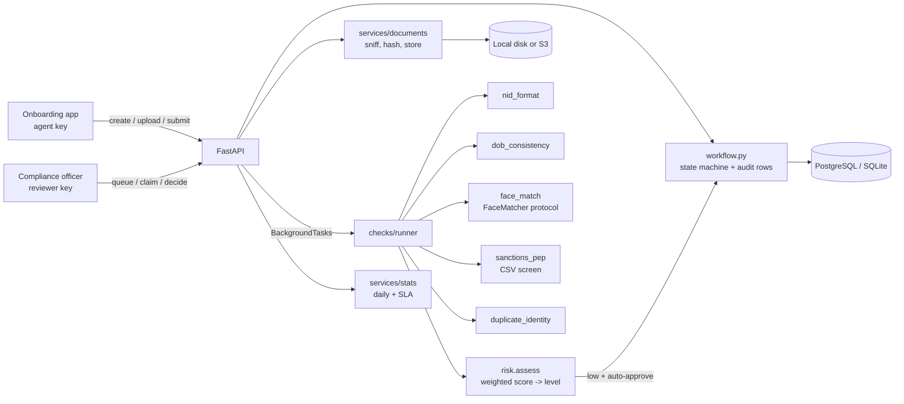

# KYC Onboarding API

FastAPI service that runs a mobile-wallet style KYC onboarding workflow: applicant intake, NID and selfie document uploads, pluggable verification checks with weighted risk scoring, a reviewer queue with role-based decisions, and SLA statistics built from the audit trail.

[](https://github.com/AkibUllah/kyc-onboarding-api/actions/workflows/ci.yml)


## Why this exists

Opening a mobile financial services account in Bangladesh means collecting a national ID (front and back), a selfie, and a handful of profile fields, then deciding within a regulator-mandated window whether the person is who they say they are. In practice the hard parts are not the form: they are validating the three NID formats in circulation, refusing spoofed uploads, catching the same ID or photo being reused across applications, screening names against sanctions and PEP lists with Bangla transliteration variance, and proving to an auditor who moved an application into which state and when. This service is that workflow core, written so each verification check is a small, independently testable plug-in and every state change is a row with an actor.

## Features

- Applicant lifecycle `draft -> submitted -> under_review -> approved | rejected | needs_more_info -> submitted`, enforced by an explicit transition table; every transition stored with actor, role, reason and time spent in the previous state
- Document intake for `nid_front`, `nid_back`, `selfie`: magic-byte type sniffing (JPEG / PNG / PDF), declared-type mismatch rejection, size limit, path-component stripping, SHA-256 hashing, replace-on-reupload
- Storage behind a `Storage` protocol: `LocalStorage` by default, `S3Storage` for any S3-compatible endpoint (boto3 imported lazily via the `[s3]` extra)
- Pluggable checks registered with a decorator: NID format (10 / 13 / 17 digits, birth-year prefix), date-of-birth consistency (adult, NID year agreement), face match (protocol + deterministic stub that fails identical files), sanctions / PEP screening against a CSV with normalised fuzzy name matching and DOB confirmation, duplicate identity (reused document hashes, NID already approved elsewhere)
- Weighted risk scoring to `low` / `medium` / `high` with configurable thresholds and profile factors; low-risk applicants auto-approved by `system` when enabled
- Checks run in FastAPI `BackgroundTasks` after submission; admins can re-run them synchronously
- Reviewer endpoints: queue filtered by risk, claim (one reviewer per applicant, admin override), decisions that require a reason for reject / needs-more-info
- Three API-key roles (`agent`, `reviewer`, `admin`) through a single `require_role` dependency
- Daily stats (created, submitted, approved, auto-approved, rejected, by risk level, average decision hours, open backlog) and SLA stats (average and max hours per state, applicants currently breaching the review SLA)
- Uniform error envelope, request-id middleware, `/health` probe with DB check, OpenAPI docs at `/docs`

## Architecture



Key decisions:

- **Transitions are data.** `workflow.transition` is the only way an applicant changes state. It validates against `TRANSITIONS`, writes a `StateTransition` with `seconds_in_previous_state`, and stamps `submitted_at` / `decided_at`. SLA reporting is a `GROUP BY from_status` over that table, nothing is computed from logs.
- **Checks are plug-ins, failures are points.** A check is `(CheckContext) -> CheckOutcome`; the runner never knows which checks exist. A crashing check is recorded as a failed outcome with a modest penalty instead of blocking the pipeline. Scores are additive and capped, so adding a check does not require re-tuning thresholds.
- **Submission is accepted, processing is asynchronous.** `POST /submit` returns 202 and schedules `process_submission` with its own DB session. The same function is callable synchronously by admins, which is also how the tests exercise it deterministically.
- **Uploads are untrusted.** Type comes from the bytes, not the header; a PNG declared as JPEG is rejected because that mismatch is a fingerprint of tampering tools. Filenames are reduced to their last path component before storage.
- **Stubs keep the real seams.** `StubFaceMatcher` and the sample sanctions CSV are clearly labelled sample implementations, but the `FaceMatcher` protocol and `SANCTIONS_CSV` setting are the actual integration points for a biometric vendor and a consolidated list.

## Tech Stack

| Layer | Choice |
| --- | --- |
| Language | Python 3.10+ |
| Framework | FastAPI, Pydantic v2, pydantic-settings |
| Persistence | SQLAlchemy 2.0 (typed `Mapped` models); PostgreSQL 16 in compose, SQLite for dev and tests |
| Storage | Local filesystem (default) or S3-compatible via boto3 (`[s3]` extra) |
| Server | uvicorn, non-root Docker image |
| Tooling | pytest + httpx TestClient, ruff, GitHub Actions (3.10 / 3.11) |

## Quick Start

### Docker

```bash
git clone https://github.com/AkibUllah/kyc-onboarding-api.git && cd kyc-onboarding-api
docker compose up --build -d
open http://localhost:8000/docs
python scripts/demo_flow.py http://localhost:8000   # needs: pip install httpx
```

### Local

```bash
make install            # venv + pip install -e ".[dev]"
cp .env.example .env
make run                # uvicorn on :8000, SQLite at ./kyc.db, files under ./storage
make test
```

### The flow in curl

```bash
BASE=http://127.0.0.1:8000
AGENT='X-API-Key: agent-dev-key'; REVIEWER='X-API-Key: reviewer-dev-key'

ID=$(curl -s -X POST $BASE/v1/applicants -H "$AGENT" -H 'Content-Type: application/json' -d '{
  "full_name": "Rahim Uddin Ahmed", "nid_number": "1990123456789", "date_of_birth": "1990-05-14",
  "phone": "01711223344", "email": "rahim@example.com", "address": "Dhanmondi, Dhaka",
  "occupation": "Shop owner", "monthly_income_bdt": 45000}' | python -c 'import json,sys; print(json.load(sys.stdin)["id"])')

for KIND in nid_front nid_back selfie; do
  curl -s -X POST $BASE/v1/applicants/$ID/documents -H "$AGENT" -F kind=$KIND -F file=@$KIND.jpg
done
curl -s -X POST $BASE/v1/applicants/$ID/submit -H "$AGENT"          # 202, checks run in background
curl -s $BASE/v1/applicants/$ID -H "$AGENT"                         # status, risk_level, risk_score
curl -s $BASE/v1/applicants/$ID/checks -H "$REVIEWER"               # per-check outcomes
curl -s $BASE/v1/review/queue -H "$REVIEWER"
curl -s -X POST $BASE/v1/review/$ID/decision -H "$REVIEWER" -H 'Content-Type: application/json' \
  -d '{"decision": "approve", "reason": "Documents verified"}'
```

## API

All business routes are under `/v1`. Roles: `agent` (A), `reviewer` (R), `admin` (always allowed).

| Method | Path | Roles | Description |
| --- | --- | --- | --- |
| POST | `/v1/applicants` | A | Create a draft applicant (BD phone and NID normalisation) |
| GET | `/v1/applicants?status=&risk_level=&limit=&offset=` | A R | Paginated listing |
| GET | `/v1/applicants/{id}` | A R | Full record incl. documents and missing documents |
| PATCH | `/v1/applicants/{id}` | A | Edit while `draft` or `needs_more_info` |
| POST | `/v1/applicants/{id}/documents` | A | Multipart `kind` + `file`; replaces an existing document of that kind |
| GET | `/v1/applicants/{id}/documents` | A R | Document metadata |
| GET | `/v1/applicants/{id}/documents/{doc_id}/content` | R | Download the stored file |
| POST | `/v1/applicants/{id}/submit` | A | `-> submitted`, schedules verification checks (202) |
| POST | `/v1/applicants/{id}/checks/run` | admin | Run or re-run checks synchronously |
| GET | `/v1/applicants/{id}/checks` | R | Check outcomes for every run |
| GET | `/v1/applicants/{id}/history` | A R | Audit trail of state transitions |
| GET | `/v1/review/queue?risk_level=&mine=` | R | Applicants under review, oldest submission first |
| POST | `/v1/review/{id}/claim` | R | Assign to the calling reviewer |
| POST | `/v1/review/{id}/decision` | R | `{decision: approve\|reject\|needs_more_info, reason}` |
| GET | `/v1/stats/daily?day=` | R | Daily throughput and decision timing |
| GET | `/v1/stats/sla` | R | Time-in-state per status and current SLA breaches |
| GET | `/health` | - | Liveness with DB check |

Errors:

```json
{"code": "upload_rejected", "message": "Declared content type does not match the file contents.",
 "details": {"declared": "image/jpeg", "detected": "image/png"}}
```

## Project Structure

```
kyc-onboarding-api/
├── kyc/
│   ├── main.py            # app factory, request-id middleware, error handler
│   ├── config.py          # pydantic-settings, API key parsing
│   ├── database.py        # SQLAlchemy engine/session (SQLite or Postgres)
│   ├── models.py          # Applicant, Document, StateTransition, CheckResult
│   ├── schemas.py         # request/response models
│   ├── auth.py            # X-API-Key principals and require_role
│   ├── workflow.py        # transition table + audited transition()
│   ├── storage.py         # Storage protocol, LocalStorage, S3Storage
│   ├── checks/            # base registry, nid, dob, face, sanctions, duplicates, risk, runner
│   ├── services/          # applicants, documents, review, stats
│   ├── routers/           # health, applicants, review, stats
│   └── data/sanctions_sample.csv
├── scripts/demo_flow.py
├── tests/                 # 40 tests: validators, risk, workflow, API flows
├── Dockerfile · docker-compose.yml · Makefile · .github/workflows/ci.yml
└── pyproject.toml · requirements*.txt · .env.example
```

## Testing

```bash
make test        # pytest -q  (40 tests, in-memory SQLite, temp-dir storage)
make lint
```

Covered: NID format rules for all three lengths, birth-year prefix extraction, age boundaries, magic-byte sniffing and every upload rejection rule, name normalisation and sanctions screening with DOB confirmation, score thresholds and factor summation, the full transition table including the `needs_more_info` loop, and end-to-end API flows: role enforcement, uploads and downloads, submission gating, background checks with auto-approval, sanctions and PEP outcomes, under-age and NID-year mismatches, identical selfie detection, reused documents and duplicate NIDs, claim conflicts and admin override, re-submission producing a second check run, and daily / SLA statistics.

## Roadmap

- Real face-match adapter (vendor SDK) and liveness signal behind `FaceMatcher`
- NID verification against the Election Commission porichoy-style API as an additional check
- Alembic migrations instead of `create_all` on startup
- Webhook or message-queue notification to the wallet core on approval
- Reviewer workload balancing and auto-assignment from the queue

## License

MIT - see [LICENSE](LICENSE).
